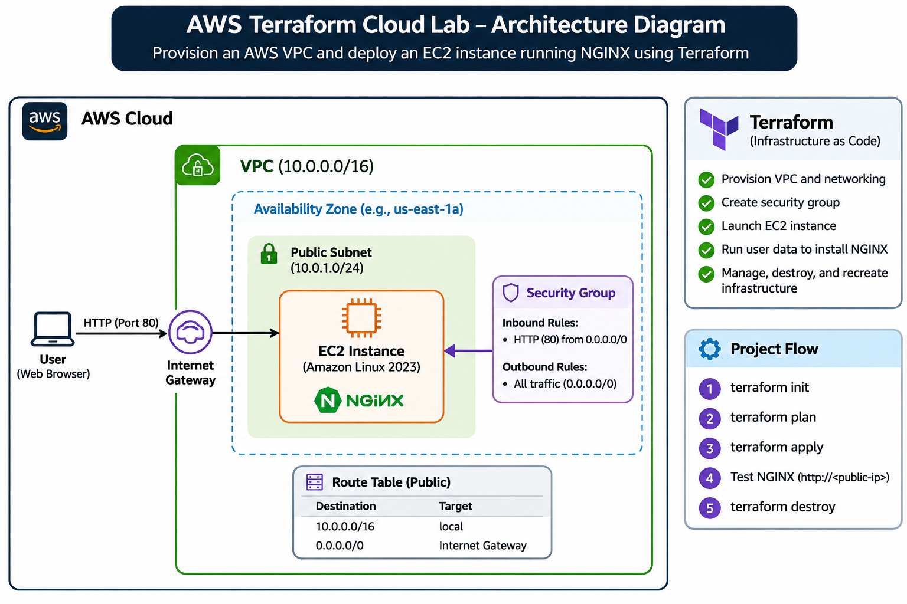

# AWS Terraform Cloud Lab

A hands-on AWS infrastructure project using Terraform to provision a Linux web server running NGINX.

## Project Overview

This project demonstrates Infrastructure as Code (IaC), AWS networking, Linux server initialization, and basic infrastructure troubleshooting.

The environment was successfully deployed and tested by accessing the NGINX welcome page through the EC2 instance's public IP address.

## Architecture Diagram



## Technologies Used

- **AWS:** VPC, EC2, Subnets, Internet Gateway, Route Tables, Security Groups
- **Terraform:** Infrastructure provisioning, state management, resource dependencies, outputs
- **Linux:** Amazon Linux 2023, Bash, DNF, systemctl
- **NGINX:** Web server installed automatically through EC2 User Data
- **Git:** Version control

## Architecture

```text
Internet
   |
Internet Gateway
   |
AWS VPC (10.0.0.0/16)
   |
Public Subnet (10.0.1.0/24)
   |
EC2 Instance (Amazon Linux 2023)
   |
NGINX Web Server (HTTP Port 80)
```

The public subnet has a default route to the Internet Gateway. The EC2 instance receives a public IP address, and its security group permits inbound HTTP traffic on TCP port 80.

## Deployment

Prerequisites:

- Terraform installed
- AWS CLI configured with appropriate credentials
- AWS permissions to provision the required resources

Initialize Terraform:

```bash
terraform init
```

Format and validate the configuration:

```bash
terraform fmt
terraform validate
```

Review infrastructure changes:

```bash
terraform plan
```

Deploy:

```bash
terraform apply
```

After deployment, Terraform displays the EC2 public IP address.

Open `http://YOUR_PUBLIC_IP` in a browser to verify the NGINX welcome page.

## Linux Automation

The `user_data.sh` script installs NGINX and configures it to start automatically.

```bash
#!/bin/bash
dnf install -y nginx
systemctl enable nginx
systemctl start nginx
```

This eliminates the need to manually install NGINX after provisioning the server.

## Cleanup

Review the destruction plan:

```bash
terraform plan -destroy
```

Remove the infrastructure:

```bash
terraform destroy
```

Verify that the managed resources were deleted successfully.

## Security and Cost Considerations

- AWS credentials are not stored in the repository.
- Terraform state and local configuration files are excluded through `.gitignore`.
- SSH access is not exposed.
- HTTP port 80 is open to the internet for demonstration purposes.
- EC2 instances, EBS storage, and public IPv4 addresses may incur AWS charges.
- Production improvements would include HTTPS, tighter network access controls, IMDSv2 enforcement, and explicit EBS encryption settings.

## Key Learning Outcomes

- Provisioned AWS networking infrastructure using Terraform.
- Connected an EC2 instance to a public subnet.
- Configured internet routing and security group rules.
- Automated Linux software installation using EC2 User Data.
- Verified web server accessibility and practiced Terraform lifecycle commands.
- Recreated infrastructure from Terraform configuration after destroying the environment.

